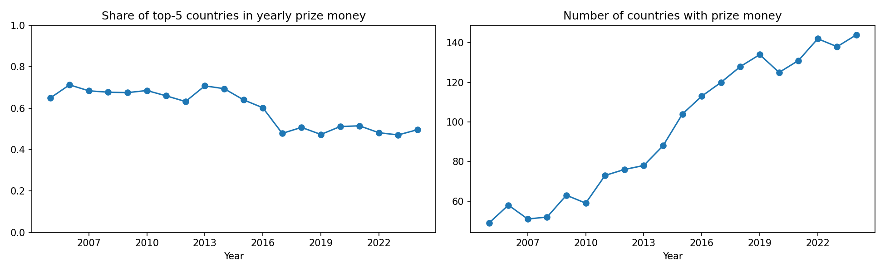

# Esports Prize Money: Market Concentration and Geography, 1998–2024

Exploratory data analysis of how esports prize money is distributed across games, genres and countries, and how this changed over time, including the effect of the 2020 pandemic.

**Author:** Daria Semenova
**Tools:** Python (pandas, matplotlib), Google Colab

## Contents

- **Part 1 – Games and genres:** `esports_prize_money_analysis.ipynb`
- **Part 2 – Countries:** `esports_geography_analysis.ipynb`

## Research questions

1. How concentrated is esports prize money among a small number of games and countries?
2. How did this concentration change between 1998 and 2024?
3. What happened to the market in 2020, and did it return to its previous structure afterwards?
4. Which genres and which countries capture most of the prize money?

## Data

- **Part 1:** Kaggle dataset [`rankirsh/esports-earnings`](https://www.kaggle.com/datasets/rankirsh/esports-earnings) (see the dataset page for the original source and licence).
  - `GeneralEsportData.csv`: one row per game (669 games). Columns: `Game`, `ReleaseDate`, `Genre`, `TotalEarnings`, `OfflineEarnings`, `PercentOffline`, `TotalPlayers`, `TotalTournaments`.
  - `HistoricalEsportData.csv`: monthly records per game (10,239 rows, January 1998 – October 2024). Columns: `Date`, `Game`, `Earnings`, `Players`, `Tournaments`.
- **Part 2:** Kaggle dataset [`jeanhousseau/esports-earnings-history`](https://www.kaggle.com/datasets/jeanhousseau/esports-earnings-history), a structured version of public data from [Esports Earnings](https://www.esportsearnings.com/), which records tournament prize money only (no salaries, sponsorships or streaming income).
  - `esports_country_earnings_by_year.csv`: prize money and number of players by country and year (2,122 rows, 178 countries, 1998–2024).
  - `esports_game_earnings_by_year.csv`: used to cross-check yearly totals.
  - `esports_player_earnings_by_year.csv`: yearly rankings of the top 100 players (not used for concentration measures because only the top 100 are listed each year).
- The data files are not included in this repository. Download them from Kaggle and place them next to the notebooks.

## Methods

- **Top-N share:** the share of yearly prize money earned by the 5 largest games (or countries).
- **Herfindahl–Hirschman Index (HHI):** the sum of squared market shares in a year. Values closer to 1 mean higher concentration.
- **Genre shares:** yearly prize money by genre, after joining the monthly data with the genre labels.
- **Prize per player:** `TotalEarnings / TotalPlayers` per game (Part 1, median by genre), and prize money per player-year by country for 2015–2024 (Part 2, countries with at least 100 player-years).
- **Data check:** yearly totals by country were compared with yearly totals by game.

## Key findings

### Part 1 – Games and genres

1. **Cumulative prize money is highly concentrated.** The 10 largest games out of 669 (about 1.5%) account for 64% of all prize money in the dataset. Dota 2 alone accounts for roughly one-fifth.
2. **Concentration across games fell over time.** The top-5 games took 99–100% of prize money in 1998–2000, about 62–67% in 2018–2019, and about 41–51% from 2020 onwards. HHI fell from 0.148 (2019) to 0.053 (2020) and stayed around 0.055–0.07 in 2021–2024.
3. **2019 looks like an outlier.** Fortnite took 31% of prize money that year (Battle Royale as a genre took 39%), which is consistent with a single mega-event, but this explanation needs an external source.
4. **2020 hit the largest tournaments.** Total prize money fell from about 258M USD (2019) to about 153M USD (2020), and Dota 2's share fell from 0.18 to 0.07. It recovered in 2021 (about 262M USD), but concentration did not return to its pre-2020 level.
5. **After 2020 no single title dominates.** The top game holds 13–18% of prize money, and mobile titles (e.g. Arena of Valor, PUBG Mobile) appear in the yearly top 3.
6. **Dispersed across games, but not across genres.** MOBA, first-person shooters and Battle Royale together hold about 78–80% of prize money in 2022–2024. Sports titles grew from about 4% (2017) to 10% (2024), while collectible card games almost disappeared.
7. **Genres differ in how prize money is spread across games and players.** Over the whole period, MOBA (29 games), first-person shooters (138) and Battle Royale (17) hold about 80% of all prize money, from 184 of 669 games. Battle Royale has the highest median prize per player (about 10,300 USD), followed by Sports (about 6,500 USD), MOBA (about 3,700 USD) and first-person shooters (about 3,100 USD). Fighting games, with 189 titles, have a median of only about 250 USD per player.

| Genre | Games | Total prize money (USD) | Median prize per player (USD) |
|---|---|---|---|
| Multiplayer Online Battle Arena | 29 | 643.8M | 3,663 |
| First-Person Shooter | 138 | 483.6M | 3,125 |
| Battle Royale | 17 | 390.4M | 10,317 |
| Strategy | 68 | 135.8M | 2,047 |
| Sports | 98 | 106.4M | 6,537 |
| Collectible Card Game | 17 | 51.5M | 2,248 |
| Fighting Game | 189 | 39.7M | 247 |
| Racing | 66 | 18.5M | 2,655 |

*Prize per player is `TotalEarnings / TotalPlayers` for each game; the table shows the median of this value across games in a genre. It is a rough measure: it includes players with very small payouts and does not adjust for inflation or time period.*

### Part 2 – Countries

8. **The geography of prize money widened.** The number of countries with prize money grew from 49 (2005) to 144 (2024).
9. **Concentration across countries fell before the pandemic.** The top-5 countries' share was about 0.63–0.71 in 2005–2014, fell from 0.60 (2016) to 0.48 (2017), and has been about 0.47–0.52 since. HHI fell from about 0.11–0.16 to about 0.064–0.080. This break is earlier than the 2020 break in the game-level data, so the pandemic does not explain it.
10. **The leading countries changed.** Share of prize money by decade: 2000–2009: United States 23%, Korea 21%, Sweden 10%; 2010–2019: United States 17%, China 16%, Korea 11%; 2020–2024: China 19%, United States 14%, Russian Federation 6%, Korea 6%, Brazil 5%.
11. **Still, a handful of countries take about half.** In 2024 the top-5 countries earn about half of all prize money among 144 countries.
12. **Total prize money and prize money per player tell different stories (2015–2024).** China leads in both total (about 302M USD) and per player-year (about 18,900 USD). The United States earns almost as much in total (about 268M USD) but spread over many more player-years (43,775), about 6,100 USD each. Smaller countries have high prize money per player-year: Denmark (about 15,500 USD), Ukraine (about 13,600), Korea (about 11,800), Finland (about 9,800) and Sweden (about 9,200).

## Figures

## Limitations

- Part 1 data are at the level of games, not players, so there is no information about countries, teams or gender. Part 2 adds countries but not gender.
- Country is the nationality of the player, not the location of the tournament.
- Country totals cover about 90–98% of the yearly totals by game, so some prize money is not attributed to a country.
- The player ranking file lists only the top 100 players per year, so concentration among players cannot be measured.
- 2024 covers only January–October and may be incomplete. The apparent decline in 2023–2024 should not be interpreted as a trend.
- Prize money is in nominal USD, without inflation adjustment.
- Prize money is not industry revenue: it excludes sponsorship, advertising, streaming and player salaries.
- Prize per player(-year) includes players with very small payouts.
- The analysis is descriptive. Explanations for the changes (pandemic, mega-events, rise of mobile games, new regions entering the market) are hypotheses and are not tested statistically.

## How to reproduce

1. Download the CSV files from the Kaggle pages above.
2. Open the notebooks in Google Colab or Jupyter.
3. Upload the CSV files and update the file paths in the first cell.
4. Run all cells.

## Possible next steps

- Add GDP per capita (World Bank) to test whether prize money is related to a country's income level.
- Test the effect of the 2020 break with a regression on yearly data.
- Adjust prize money for inflation.
